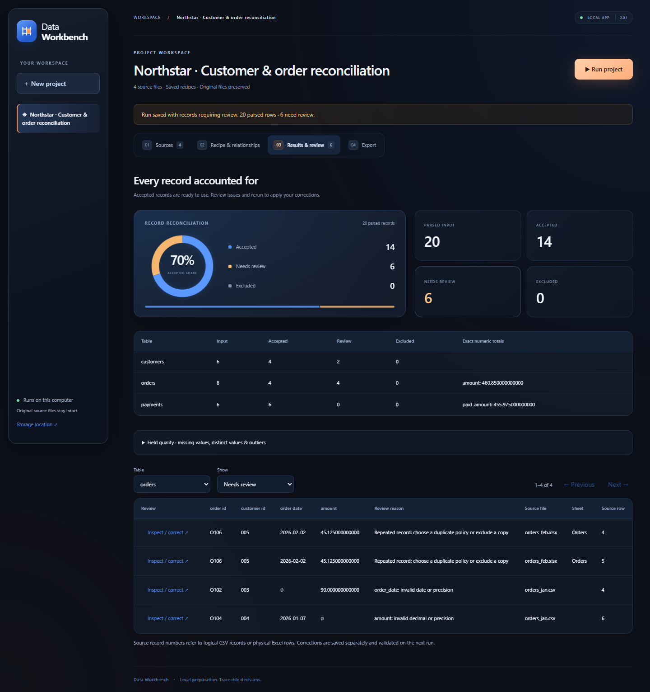

# Data Workbench

Data Workbench is a local app for preparing related CSV and Excel files. You can combine exports, save cleaning rules, review questionable records, and join tables while keeping a record of where each value came from.

The preparation steps stay visible and repeatable. The app keeps original files, separates corrections from raw values, and checks that joins don't multiply the records in the base table.

[View the workspace](docs/images/review-2.0.1.png) · [Download version 2.0.1](deliverables/Data-Workbench-2.0.1.zip) · [Operating guide](docs/OPERATING_GUIDE.md) · [Comparison and limits](docs/COMPARISON.md)



The separate [Excel Export Consolidator](https://github.com/ZakJRademacher/excel-export-consolidator) runs inside Excel with native Power Query. Workbench is the configurable Python application for CSV/XLSX sources and related tables.

## Open the app

On Windows, install standard **64-bit Python 3.12 or newer** from [python.org](https://www.python.org/downloads/windows/), including its launcher or PATH option. Download and fully extract the ZIP into a writable folder, then double-click **[Start Workbench.cmd](Start%20Workbench.cmd)**. The local app opens at **http://127.0.0.1:8810**. Keep its terminal window open while working; Ctrl+C stops it. The first launch needs internet access and installs pinned dependencies into `%LOCALAPPDATA%/DataWorkbench/venv`. A standard Anaconda/Miniconda installation is also recognized. For a custom installation set `DATA_WORKBENCH_PYTHON` to its Python executable.

The launcher and extracted download were tested with a separate Python 3.13.9 installation. On other operating systems, create a Python virtual environment, install `requirements.lock.txt`, and run `python -m workbench.app`; the double-click launcher was verified on Windows only.

Choose **Explore the demo** for a fictional customer, order, and payment project, or **Create a project** to add your own files.

## What it does

- Profiles CSV and `.xlsx` sources; lets you choose worksheet, header, delimiter, and encoding.
- Appends compatible exports through editable source-to-field mappings.
- Applies saved types, whitespace and category rules, reusable per-source date/number formats, required fields, bounds, decimal scale, and cross-field comparisons.
- Keeps identifiers as text, uses exact decimals, and preserves source bytes and record references.
- Flags conflicting keys, invalid records, and repeated records. Saves corrections and explicit exclusions separately from original files.
- Suggests exact-key relationships, previews unmatched and output row counts, and requires approval before publishing combined views.
- Aggregates child tables before joins when necessary to preserve the base table's grain.
- Exports complete CSVs, a review workbook, the audit, the recipe, review decisions, a data dictionary, a closed DuckDB snapshot, and a hash manifest.
- Reuses an unchanged, verified run. Changed data, rules, or decisions create a new run. Stale results are visibly labeled.

## Start with the demo

The first run has **20 input records = 14 accepted + 6 needing review**. Accepted order amount is **460.8500 source units**; accepted payment amount is **455.9750 source units**. Orders and payments have different accepted records at this stage, so these two totals are not an all-order/payment reconciliation.

There are two conflicting customer copies, one ambiguous order date, one invalid amount, and two copies of the same order. The fixtures are original fictional data, with no assumed currency. See [the operating guide](docs/OPERATING_GUIDE.md) for a complete review exercise and its expected results.

## Limits and interpretation

Workbench accepts up to **50 sources, 50 MB each, 250 MB combined, and 1,000,000 parsed input rows**, with one processing job at a time. It reads CSV and one selected `.xlsx` sheet per source. Formula values depend on workbook caches; dates need an explicit format. It does not infer currencies, merge similar entities, or recalculate Excel formulas. File errors mark a project incomplete, even when readable sources produce partial outputs. [Complete input, precision, review, and storage limits](docs/OPERATING_GUIDE.md#limits-and-interpretation).

## Implementation and checks

[Architecture and API](docs/TECHNICAL.md) · [Operating guide](docs/OPERATING_GUIDE.md) · [Verification](docs/QA.md) · [Benchmark reproduction](docs/BENCHMARKS.md) · [Dependency licenses](licenses/README.md)

From the app folder, using an environment with `requirements-dev.txt` installed:

```powershell
python -B -m pytest tests -q
python -B tools/browser_check.py --workdir C:/Temp/DataWorkbenchBrowser --evidence evidence/browser
python -B tools/benchmark.py --workdir C:/Temp/DataWorkbenchBenchmark --evidence evidence/million-row-check.json
```

Use a scratch location outside OneDrive for the generated benchmark data. The benchmark records measured elapsed time and peak process working memory; it does not impose a universal speed promise for every workbook shape.

## Project scope and licenses

This independent project includes original fictional demo records. Before using your own data, confirm the mappings, keys, missing-value rules, and what one row represents. The benchmark guides show which cases were checked and where the app needs more care, including scientific numeric precision.

Application code and the fictional demo are covered by [MIT](LICENSE). Runtime dependency notices remain in [licenses](licenses/README.md). External datasets retain their publishers' terms and are not bundled. The [original Excel Export Consolidator](https://github.com/ZakJRademacher/excel-export-consolidator) remains available for the native Power Query workflow.

## Benchmark context

The [comparison and limits](docs/COMPARISON.md) distinguish current application checks from historical external benchmarks of version 2.0.0. [Additional public-source checks](docs/ADDITIONAL_BENCHMARKS.md) document scientific precision limits. The earlier 2.0.0 package remains available in [repository history](https://github.com/ZakJRademacher/data-workbench/blob/79d89586061172ac1f6a9a58dc3eb913b4976966/deliverables/Data-Workbench-2.0.0.zip); these cases are not universal correctness or speed guarantees.
