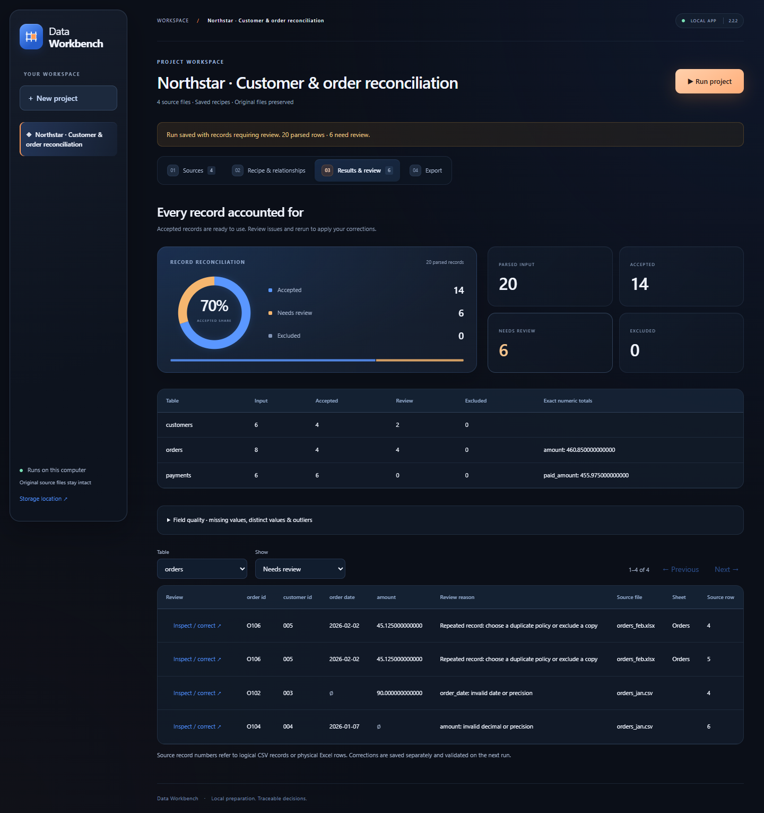

# Data Workbench

Data Workbench is a local app for preparing related CSV and Excel files. You can combine exports, save cleaning rules, review questionable records, and join tables while keeping a record of where each value came from.

The preparation steps stay visible and repeatable. The app keeps original files, separates corrections from raw values, and checks that joins don't multiply the records in the base table.

[Download for Windows](https://github.com/ZakJRademacher/data-workbench/releases/latest) · [View the workspace](docs/images/review-2.2.2.png) · [Operating guide](docs/OPERATING_GUIDE.md) · [Comparison and limits](docs/COMPARISON.md)



## Open the app

On 64-bit Windows, download `Data-Workbench-<version>-windows-x64.zip` from the latest release (from 2.3.0). Fully extract it into a writable folder with a short path, such as `C:\DataWorkbench`, then double-click **[Start Workbench.cmd](Start%20Workbench.cmd)**. The ZIP carries its own Python 3.14 and the pinned dependencies in `runtime\python`, so nothing needs to be installed and the first launch works offline. The local app opens at **http://127.0.0.1:8810**. Keep its terminal window open while working; Ctrl+C stops it. To upgrade, stop the app, extract the new version into a new folder, and copy your `projects` folder across.

The smaller `Data-Workbench-<version>.zip` holds the same app without Python. It needs standard **64-bit Python 3.12 or newer** from [python.org](https://www.python.org/downloads/windows/). Its first launch needs internet access and installs the pinned dependencies into `%LOCALAPPDATA%/DataWorkbench/venv`. A standard Anaconda/Miniconda installation is also recognized. For a custom installation set `DATA_WORKBENCH_PYTHON` to its Python executable.

On every push, Windows clean-install checks extract both downloads and run the built-in demo: the bundled download with every installed Python hidden, and the smaller one with Python 3.12. On other operating systems, create a Python virtual environment, install `requirements.lock.txt`, and run `python -m workbench.app`.

Choose **Explore the demo** for a fictional customer, order, and payment project, or **Create a project** to add your own files.

## What it does

- Profiles CSV and `.xlsx` sources; lets you choose worksheet, header, delimiter, and encoding.
- Appends compatible exports through editable source-to-field mappings.
- Applies saved types, UTC timestamp conversion, whitespace and category rules, reusable per-source formats and missing markers, required fields, decimal scale and opt-in rounding, and cross-field comparisons.
- Keeps identifiers as text, uses exact decimals, and preserves source bytes and record references.
- Flags conflicting keys, invalid records, and repeated records. An optional source setting holds safely readable malformed rows for review. Saves corrections and exclusions separately from original files.
- Suggests exact-key relationships, previews unmatched and output row counts, and requires approval before publishing combined views.
- Aggregates child tables before joins when necessary to preserve the base table's grain.
- Exports complete CSVs, a review workbook, the audit, the recipe, review decisions, a data dictionary, a closed DuckDB snapshot, and a hash manifest.
- Reuses an unchanged, verified run. Changed data, rules, or decisions create a new run. Stale results are visibly labeled.

## Start with the demo

The first run has **20 input records = 14 accepted + 6 needing review**. Accepted order amount is **460.8500 source units**; accepted payment amount is **455.9750 source units**. Orders and payments have different accepted records at this stage, so these two totals are not an all-order/payment reconciliation.

There are two conflicting customer copies, one ambiguous order date, one invalid amount, and two copies of the same order. The fixtures are original fictional data, with no assumed currency. See [the operating guide](docs/OPERATING_GUIDE.md) for the demo walkthrough and expected results.

## Try payout reconciliation

The command-line reconciliation preview matches Stripe payouts to QuickBooks deposits, checks payout arithmetic when given an itemized report, and writes a tie-out with exceptions for review. Version 2.2.0 can use an earlier monthly close to distinguish a payout that remains open from one already booked. The QuickBooks profile was verified against native CSV and Excel exports from Intuit's sample company. Stripe and paired-export verification remains open.

After the first Windows launch, open PowerShell in the extracted `data-workbench` folder. These commands use the Python the launcher uses, bundled or set up on first launch:

```powershell
$workbenchPython = if (Test-Path runtime\python\python.exe) { Resolve-Path runtime\python\python.exe } else { Join-Path $env:LOCALAPPDATA 'DataWorkbench\venv\Scripts\python.exe' }
& $workbenchPython -X utf8 -m workbench.recon.synth --out recon-demo
& $workbenchPython -X utf8 -m workbench.recon --payouts recon-demo/stripe_payouts.csv --itemized recon-demo/stripe_itemized.csv --books recon-demo/quickbooks.csv --period 2026-10 --out recon-results
```

Open `recon-results/summary.md` to read the tie-out and review items. [Matching rules, test evidence, and limits](docs/RECONCILIATION_DESIGN.md#phase-1-status).

It also matches Shopify orders to Shopify Payments and WooCommerce orders to Stripe charges. It checks order references, currency, amount, and customer evidence; ambiguous cases go to review, and disputes are tied to their orders. On 98,285 real Olist orders with the order IDs hidden it matched 99.24% automatically with no wrong matches. The two store export layouts were built from the platforms' documentation and still need checking against native exports. [Match store orders](docs/RECONCILIATION_DESIGN.md#match-store-orders-to-payments) · [Carry a payout close forward](docs/RECONCILIATION_DESIGN.md#carry-state-into-next-months-payout-reconciliation)

## Limits and interpretation

Workbench accepts up to **50 sources, 50 MB each, 250 MB combined, and 1,000,000 parsed input rows**, with one processing job at a time. It reads CSV and one selected `.xlsx` sheet per source. Formula values depend on workbook caches; dates need an explicit format. It does not infer currencies, merge similar entities, or recalculate Excel formulas. File errors mark a project incomplete, even when readable sources produce partial outputs. [Complete input, precision, review, and storage limits](docs/OPERATING_GUIDE.md#limits-and-interpretation).

## Implementation and checks

**Real-data regression suite.** Every push runs a slice of four public datasets through the app on Linux and Windows, and every night runs all 1,554,645 rows. Each count, total, join gap and exported value is compared with an [independent reference implementation](https://github.com/ZakJRademacher/data-workbench/blob/main/realdata/oracle.py) that uses only Python's standard library. Datasets are pinned by URL and SHA-256. [How it works](https://github.com/ZakJRademacher/data-workbench/tree/main/realdata).

[Architecture and API](docs/TECHNICAL.md) · [Operating guide](docs/OPERATING_GUIDE.md) · [Verification](docs/QA.md) · [Benchmark reproduction](docs/BENCHMARKS.md) · [Dependency licenses](licenses/README.md)

From the app folder, using an environment with `requirements-dev.txt` installed:

```powershell
python -B -m pytest tests -q
python -B tools/browser_check.py --workdir C:/Temp/DataWorkbenchBrowser --evidence evidence/browser
python -B tools/benchmark.py --workdir C:/Temp/DataWorkbenchBenchmark --evidence evidence/million-row-check.json
```

Use a scratch location outside OneDrive for the generated benchmark data. The benchmark records measured elapsed time and peak process working memory; it does not impose a universal speed promise for every workbook shape.

## Project scope and licenses

This independent project includes original fictional demo records. Before using your own data, confirm the mappings, keys, missing-value rules, and what one row represents. The benchmark guides show which cases were checked and where the app needs more care, including scientific numeric precision.

Application code and the fictional demo are covered by [MIT](LICENSE). Runtime dependency notices remain in [licenses](licenses/README.md). External datasets retain their publishers' terms and are not bundled.

## Benchmark context

The [comparison and limits](docs/COMPARISON.md) distinguish current application checks from historical external benchmarks of version 2.0.0. [Additional public-source checks](docs/ADDITIONAL_BENCHMARKS.md) document scientific precision limits. The earlier 2.0.0 package remains available in [repository history](https://github.com/ZakJRademacher/data-workbench/blob/79d89586061172ac1f6a9a58dc3eb913b4976966/deliverables/Data-Workbench-2.0.0.zip); these cases are not universal correctness or speed guarantees.
